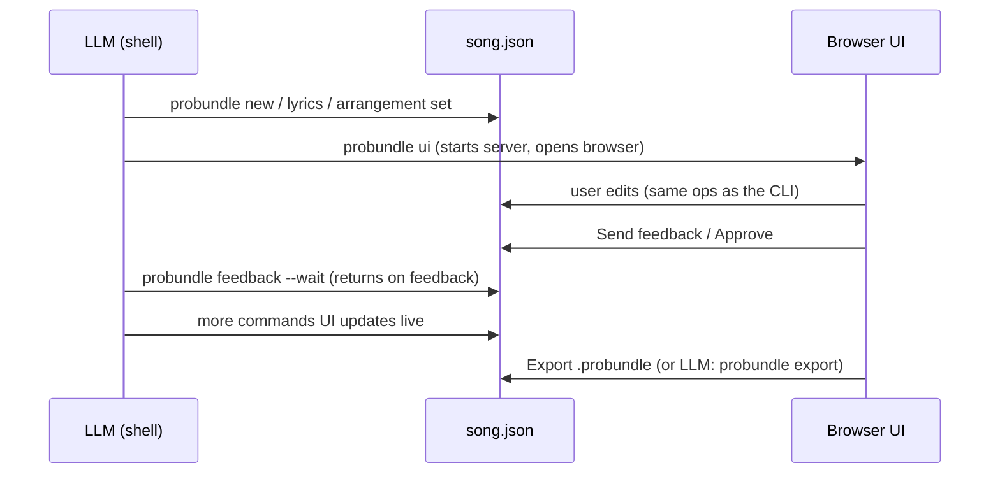

# probundle

Build ProPresenter `.probundle` song files with an LLM, and review them in a browser UI.

The tool has no LLM inside. An LLM (Claude Code, Codex, any agent with a shell) runs `probundle`
commands to write the song. The user sees the song in a local web UI, edits it there, and sends
feedback. The LLM reads the feedback with `probundle feedback --wait` and changes the song.
The result is a `.probundle` file that ProPresenter imports.



## Install

```sh
go install ./cmd/probundle        # puts probundle in $(go env GOPATH)/bin
```

## Use with an LLM

Tell the LLM: "Run `probundle guide` and make a probundle for <song>, with these lyrics: …".
The guide has the workflow, the lyrics format, the house style and every op.

Short version:

```sh
probundle new song.json --title "Nimesi sun" --artist "Suhe Live" --lyrics lyrics.txt
probundle arrangement set song.json Standard Blank "Verse 1" Chorus "Verse 1" Chorus Bridge Chorus
probundle ui song.json                 # the user reviews here
probundle feedback song.json --wait    # blocks until the user sends feedback or approves
probundle export song.json             # writes "<title>.probundle" next to song.json
```

Lyrics format: `[Group]` header lines, blank lines between slides, one line per slide line.

## What the bundle contains

- A Blank group first: empty slide, the "Worship slides look" macro, and a looping background video
  (`probundle backgrounds` lists the choices).
- One group per section (Verse 1, Chorus, …) with several slides, in the church slide style
  (Beausite Classic, white, capitals, black outline). Verse 1, Chorus and Bridge link to the church library groups.
- Arrangements, with one selected.
- No video file. The background points to the video on the church Mac (`~/Documents/MotionBackgrounds2026/…`).

## Other commands

```sh
probundle inspect FILE.probundle [--json]   # look inside any bundle, check manifest hashes
probundle new song.json --from OLD.probundle  # edit an existing song; merges one-slide groups
probundle help                              # all commands
```

## Development

- Format spec: [`docs/probundle-format.md`](docs/probundle-format.md)
- Samples: `samples/` (ProPresenter 21.x exports)
- Schema: `third_party/ProPresenter7-Proto/autogen-proto` (see `VENDORED.txt`); Go bindings in
  `internal/rvpb`, made by `./scripts/gen-protos.sh` (needs `protoc` and `protoc-gen-go`).
- Template: `internal/bundle/template.pro`, made from the samples:

  ```sh
  go run ./cmd/make-template internal/bundle/template.pro "samples/Nimesi sun.probundle" "samples/Suuruutes Äärellä.probundle"
  ```

  The first sample gives the slide style and the Blank slide; every sample adds its background and library groups.
  To change the look, export a song with the new look from ProPresenter, put it first, and run the command again.
- Tests: `go test ./...`

| Package | Job |
|---------|-----|
| `internal/song` | Song model, lyrics format, ops (shared by CLI and UI), validation |
| `internal/store` | State file with lock, revision counter and the event log between UI and LLM |
| `internal/rtf` | Cocoa RTF for slide text |
| `internal/bundle` | Read/repair, template, build `.pro`, export ZIP + manifest, import |
| `internal/server` | Local HTTP server and the embedded UI (`ui/index.html`) |

## Agent skill

`skills/probundle/SKILL.md` teaches an agent when and how to use the tool (lyrics rules, feedback loop, finish checks).
For Claude Code: `ln -s ~/Projects/propresenter-probundle/skills/probundle ~/.claude/skills/probundle`.
