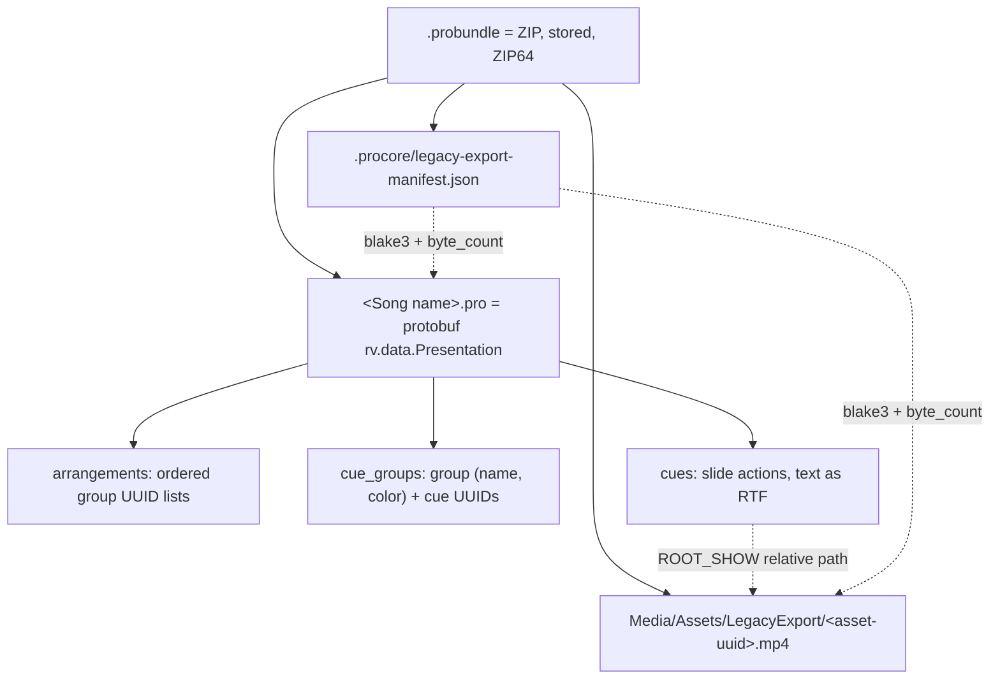

# ProPresenter `.probundle` format (reverse engineered)

Sample: `samples/Suuruutes Äärellä.probundle`.
Exported by ProPresenter 21.x on the church production Mac (user `tuotanto`).
Inspect any bundle with `tools/inspect_probundle.py BUNDLE [--json|--extract DIR]`.

Status labels in this document:

- **Observed**: seen in the sample bytes.
- **Inference**: not proven. Test it on a ProPresenter machine before you rely on it.

## 1. Layers



## 2. ZIP container

Observed members, in this order:

| # | Member | Size | Content |
|---|--------|------|---------|
| 1 | `.procore/legacy-export-manifest.json` | 1681 | Export manifest (section 3) |
| 2 | `Media/Assets/LegacyExport/1a4b1816-3ad0-45da-b688-980683080757.mp4` | 13704683 | Background video, H.264 1920x1080, 30 fps, 30.0 s |
| 3 | `Suuruutes Äärellä.pro` | 14557 | The presentation document (section 4) |

Observed writer properties:

- Compression method 0 (stored) for all members. No data descriptors (flag bit 3 is clear).
- All members use ZIP64. Local and central headers set sizes to `0xFFFFFFFF` and put the real
  values in a ZIP64 extra field (`0x0001`, 24 bytes: uncompressed size, compressed size, local header offset).
  The central header also writes the real offset in the 32-bit offset field.
- Version made by `0x031E` (Unix, 3.0). Version needed `45`. External attributes `0` (no Unix permissions).
- Member names are UTF-8 in **NFD** form (`A` + `U+0308` for `Ä`), which is the macOS file system form.
  The UTF-8 flag (general purpose bit 11) is **not** set. Strict readers decode the names as CP437.
- **Writer bug**: the "size of central directory" value in the ZIP64 end record and in the classic end
  record is 98 bytes too large. 98 = 56 (ZIP64 end record) + 20 (ZIP64 locator) + 22 (end record).
  The writer counts the end records as part of the central directory.
  Python `zipfile` rejects the file. `unzip` warns and continues. `inspect_probundle.py` patches the value in memory.

Inference for the generator: a standard, valid ZIP (stored, UTF-8 names) is the safe choice.
ProPresenter must read normal ZIP files, because it reads its own bundles with this bug.
Do not copy the bug. Keep the NFD file names and the member order, because they cost nothing.

## 3. `.procore/legacy-export-manifest.json`

Observed (paths shortened):

```json
{
  "version": 1,
  "target_contract": "presentation_bundle",
  "source_root": "/Users/tuotanto/Library/Application Support/RenewedVision/ProPresenter/Workspaces/7ec18c1e-…",
  "target_root": "/private/var/folders/…/T/37D988EF-…/bundle",
  "documents": [{
    "document_id": "bf5546ca-d9aa-491d-8aeb-4b611e69c6e7",
    "location": { "type": "collection", "kind": "presentation", "core_path": "Songs/Suuruutes Äärellä" },
    "output_path": "Suuruutes Äärellä.pro",
    "byte_count": 14557,
    "blake3": "a85bcf4d…",
    "reopened": true
  }],
  "media": [{
    "output_path": "Media/Assets/LegacyExport/1a4b1816-….mp4",
    "byte_count": 13704683,
    "blake3": "260e3185…"
  }],
  "media_references": [{
    "document_id": "bf5546ca-…",
    "scope": "shared",
    "occurrence_path": "/root/cues/02498B6E-…/actions/2/ActionTypeData/media/element",
    "reference_id": "a7149ca4-…",
    "asset_id": "1a4b1816-…",
    "source_path": "/Users/tuotanto/Documents/MotionBackgrounds2026/CMG - Thermal Glow - Motion Backgrounds/Thermal Glow Electric - Medium - HD 1080.mp4",
    "output_path": "Media/Assets/LegacyExport/1a4b1816-….mp4",
    "locator_rewritten": true
  }],
  "compatibility_warnings": [],
  "elapsed_millis": 221
}
```

| Field | Meaning |
|-------|---------|
| `document_id` | Presentation UUID (`Presentation.uuid`), **lowercase** here, uppercase in the `.pro`. |
| `location.core_path` | Library path in the ProPresenter 21 workspace: library `Songs`, document name. |
| `byte_count`, `blake3` | Size and BLAKE3-256 hex of the member bytes. Verified: both match. |
| `media_references[].occurrence_path` | Path into the `.pro`: cue UUID, action index (0-based), then the media element. |
| `reference_id` | `Media.uuid` of the media element in that action (lowercase). |
| `asset_id` | Asset UUID. It is also the file name of the media member and unknown field 10 of `Media` (section 4.6). |
| `source_path` | Original absolute path on the exporting Mac. Informational. |
| `locator_rewritten` | The exporter changed the media URL in the `.pro` to the bundle-relative path. |
| `reopened` | Inference: the exporter parsed the written `.pro` again as a check. |

The name `legacy-export` and the `Workspaces/<uuid>` source show that ProPresenter 21 stores documents
in a workspace database. The `.probundle` is a compatibility export of the ProPresenter 7 file format.

Inference: the manifest is optional for import, because ProPresenter 7 bundles had no manifest.
The generator writes it anyway, with correct hashes.

## 4. `<name>.pro` (protobuf `rv.data.Presentation`)

Schema: `vendor/ProPresenter7-Proto/autogen-proto` (community reverse-engineered, generated for
ProPresenter 21.4). Decode: `protoc -I vendor/ProPresenter7-Proto/autogen-proto --decode rv.data.Presentation presentation.proto < FILE.pro`.

Observed: decode then re-encode with Python protobuf gives the same bytes. Only 3 unknown fields exist (section 4.6).

### 4.1 Top-level fields present

| Field | # | Value |
|-------|---|-------|
| `uuid` | 2 | `BF5546CA-D9AA-491D-8AEB-4B611E69C6E7` (uppercase UUID string in all `.pro` UUIDs) |
| `background` | 8 | `color { alpha: 1 }` (black) |
| `selected_arrangement` | 10 | UUID of arrangement "Standard" |
| `arrangements` | 11 | 1 arrangement (section 4.3) |
| `cue_groups` | 12 | 10 groups (section 4.2) |
| `cues` | 13 | 10 cues (section 4.4) |
| `ccli` | 14 | `song_title: "Suuruutes Äärellä"`, `artist_credits: "Newland"`, `display: true` |
| `timeline` | 17 | `duration: 300` |

Not present: `application_info`, `name`, `category`, `notes`, dates, `music_key`, `transition`.
**The presentation name is the `.pro` file name** (and `core_path` in the manifest).

### 4.2 Groups (`cue_groups`)

Each `CueGroup` = `group` (UUID, `name`, `color`, empty `hotKey`) + ordered `cue_identifiers`.
The order of `cue_groups` is the slide order in the editor. The order of `cues` is not relevant
(observed: it is creation order, not display order).

Observed convention in this song: **each group holds exactly one cue**. Sections with more slides
use more groups with the same name and color, for example 2 groups "Verse 1" and 4 groups "Chorus".
Group UUIDs are unique; names are not unique.

| Group name | RGBA | Groups | Notes |
|------------|------|--------|-------|
| Blank | (0, 0, 0, 1) | 1 | Has `application_group_identifier` `9E2D347C-F899-4FB5-BB14-F98607508BBA` (link to a library group on the church Mac) |
| Verse 1 | (0, 0.4667, 0.8, 1) | 2 | |
| Verse 2 | (0, 0.3490, 0.6, 1) | 2 | |
| Chorus | (0.8, 0, 0.3059, 1) | 4 | |
| Bridge | (0.4627, 0, 0.8, 1) | 1 | |

### 4.3 Arrangements

`Arrangement` = `uuid`, `name`, ordered `group_identifiers` (group UUIDs, repeats allowed).
Sample arrangement "Standard" (29 entries, by group name):

```
Blank, V1, V1, V2, V2, Ch, Ch, Ch, Ch,
       V1, V1, V2, V2, Ch, Ch, Ch, Ch,
       Ch, Ch, Ch, Ch,
       Br, Br, Br, Br,
       Ch, Ch, Ch, Ch
```

Each `V1`/`Ch` above is a different group UUID with that name (for example, the 4 chorus groups in order).
The bridge has one group, repeated 4 times. Without an arrangement, ProPresenter plays the groups in `cue_groups` order.

### 4.4 Cues

Every cue: `uuid`, `completion_action_type: COMPLETION_ACTION_TYPE_LAST`, empty `hot_key`, `isEnabled: true`, `actions`.

**Blank cue** (first group). 3 actions, in this order:

1. `ACTION_TYPE_PRESENTATION_SLIDE`: empty slide (`size` 1920x1080, `uuid`, no elements).
   Action `label.text` = media file name `Thermal Glow Electric - Medium - HD 1080.mp4`.
2. `ACTION_TYPE_MACRO`: macro reference by UUID **and** name:
   `parameter_uuid 83ECECA5-C935-4FF3-8983-4EA34FB72546`, `parameter_name "Worship slides look"`,
   parent collection `123E432F-2432-469B-81E5-2C68442AB0A4` "Default Collection".
   The macro lives on the church Mac. Inference: it sets the "look" (screen/layer config) for worship lyrics.
3. `ACTION_TYPE_MEDIA`, `duration: 30`: background video. See section 4.6.

**Lyric cue**. 1 action: `ACTION_TYPE_PRESENTATION_SLIDE` with one text element.
All 9 lyric cues are identical except: UUIDs (cue, action, slide, element), `rtf_data`, and the
`custom_attributes[].range.end` values.

### 4.5 Lyric slide text element

`slide.presentation.base_slide`: `size` 1920x1080, `uuid`, one entry in `elements`:

| Path | Value |
|------|-------|
| `info` | `3` = `INFO_IS_TEMPLATE_ELEMENT \| INFO_IS_TEXT_ELEMENT`. Inference: the "look" restyles this element because of the template flag. |
| `text_scroller` | `scroll_rate 0.5`, `should_repeat true`, `repeat_distance 0.0617…` (scroller is not enabled) |
| `element.name` | `"Text"` |
| `element.bounds` | origin (150, 100), size 1620x880 |
| `element.opacity` | 1 |
| `element.path` | closed rectangle, 4 unit-square points (0,0) (1,0) (1,1) (0,1), `q0`/`q1` = point, `shape.type TYPE_RECTANGLE` |
| `element.fill` | color (0.13, 0.59, 0.95, 1). `enable` not set, so no fill shows. |
| `element.stroke` | width 3, white. Not enabled. |
| `element.shadow` | angle 315, offset 5, radius 5, black, opacity 0.75. Not enabled. |
| `element.feather` | radius 0.05. Not enabled. |
| `element.text.attributes.font` | `Helvetica-Bold`, size 60, bold, family `Helvetica` |
| `element.text.attributes.capitalization` | `CAPITALIZATION_ALL_CAPS` |
| `element.text.attributes.text_solid_fill` | white |
| `element.text.attributes.paragraph_style` | `ALIGNMENT_CENTER`, `line_height_multiple 1`, one empty tab stop, `default_tab_interval 65` |
| `element.text.attributes.stroke_width` / `stroke_color` | -2 / black |
| `element.text.attributes.custom_attributes` | 2 entries, both `range { end: N }`: one `capitalization ALL_CAPS`, one `original_font` (same font). |
| `element.text.shadow` | angle 315.87, offset 4, black, opacity 1. Not enabled. |
| `element.text.vertical_alignment` | `VERTICAL_ALIGNMENT_MIDDLE` |
| `element.text.transformDelimiter` | `"  •  "` |
| `element.text.chord_pro.color` | (0.993, 0.76, 0.032, 1) |
| `element.text.rtf_data` | Slide text as Cocoa RTF (below) |
| `element.text_line_mask` | empty |

`N` in `range.end` = length of the plain text in UTF-16 code units, line breaks included.
Example: `"Korkein oot\nkorkein oot"` gives 23.

`rtf_data` (bytes, ASCII). Exact template, with `{TEXT}` as the only variable part:

```rtf
{\rtf1\ansi\ansicpg1252\cocoartf2907
\cocoatextscaling0\cocoaplatform0{\fonttbl\f0\fswiss\fcharset0 Helvetica-Bold;}
{\colortbl;\red255\green255\blue255;\red255\green255\blue255;\red0\green0\blue0;}
{\*\expandedcolortbl;;\cssrgb\c100000\c100000\c100000;\cssrgb\c0\c0\c0;}
\deftab1300
\pard\tx0\pardeftab1300\pardirnatural\qc\partightenfactor0

\f0\b\fs120 \cf2 \outl0\strokewidth-40 \strokec3 {TEXT}}
```

Encoding rules for `{TEXT}`:

- Line break: backslash + newline (`\` `\n`).
- CP1252 non-ASCII characters: `\'xx` (lowercase hex). Example: `ä` is `\'e4`.
- Characters outside CP1252: Inference: Cocoa writes `\uc0\uNNNN ` (decimal UTF-16 unit).
- `\`, `{`, `}`: escape with a backslash.
- `\fs120` = 60 pt (half points). `\strokewidth-40` = text `stroke_width -2`. `\cf2` = white, `\strokec3` = black.
- ALL CAPS is a display attribute. The RTF keeps the original letter case.

### 4.6 Background media action (Blank cue, action 2)

`media.element` (`rv.data.Media`):

| Path | Value |
|------|-------|
| `uuid` | `A7149CA4-…` (= manifest `reference_id`) |
| `url.local` | `root: ROOT_SHOW`, `path: "Media/Assets/LegacyExport/<asset>.mp4"` (bundle-relative) |
| `metadata` | `format "h264"`, `color_format COLOR_FORMAT_SDR` |
| `video.drawing` | `natural_size` 1920x1080, empty `custom_image_bounds`, empty `crop_insets`, `ALPHA_TYPE_STRAIGHT` |
| `video.audio.volume` | 1 |
| `video.transport` | `play_rate 1`, `out_point 30`, `end_point 30`, `PLAYBACK_BEHAVIOR_LOOP`, `times_to_loop 1`, `RETRIGGER_SETTING_AUTOMATIC` |
| `video.video` | `frame_rate 30`, `thumbnail_position -1`, `soft_loop_duration 0.5` |
| `video.file.local_url.local` | same `ROOT_SHOW` path |
| unknown `video` field 6 | `{1: FileProperties{1: URL{4: local{root 10 (ROOT_SHOW), path}}}}`. Same path again. Not in the public schema. |
| unknown field 10 | `{1: "1A4B1816-3AD0-45DA-B688-980683080757"}` = asset UUID (uppercase). ProPresenter 21 asset ID. |
| unknown field 11 | `"1"`. Inference: asset revision. |

`media.audio` is an empty message. `ROOT_SHOW` (enum 10) resolves relative to the bundle on import.
Inference: on import, ProPresenter copies the media into its library and rewrites the URL.

## 5. Implications for a generator

- Build the `.pro` from the sample as a template: copy the Blank cue unchanged (macro + background),
  and clone the lyric cue for each slide. Change only UUIDs, `rtf_data` and `range.end`.
  This keeps every styling field ProPresenter expects, including fields with no schema name.
- New UUIDs for presentation, arrangement, groups, cues, actions, slides and elements.
  Uppercase in the `.pro`, lowercase in the manifest.
  Inference: keep the Blank group `application_group_identifier`, the macro UUID and the asset UUID unchanged,
  because they point to objects that exist on the church Mac.
- Name the `.pro` member `<Song title>.pro` (NFD). Set `ccli.song_title` and `ccli.artist_credits`.
- Background video: either embed the same mp4 (13.7 MB per bundle, as the export does), or test whether
  an import without the mp4 resolves the asset UUID to the existing library media. Not tested.
- Write a valid ZIP (section 2) and a manifest with correct BLAKE3 hashes (section 3).

## 6. Open questions (need a ProPresenter machine)

1. Does import work without `.procore/legacy-export-manifest.json`?
2. Does import work without the embedded mp4, if the asset UUID already exists in the library?
3. Does import create duplicate media each time the same asset is imported?
4. Does a standard ZIP (correct central directory size, UTF-8 flag set) import correctly? Expected: yes.
5. Is "one group per slide" a deliberate house style, or an artifact of how the song was made?
   ProPresenter also supports one group with many cues.
